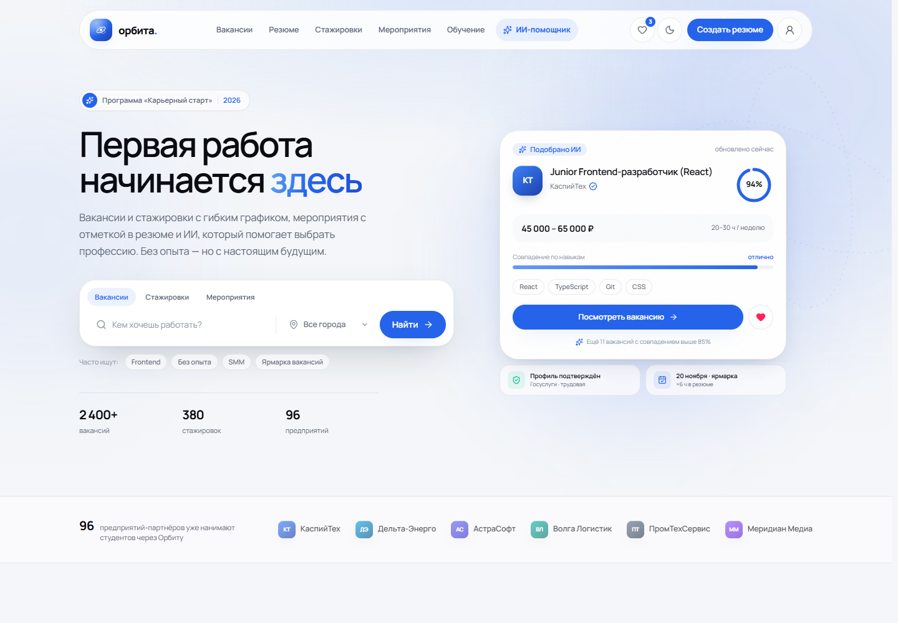
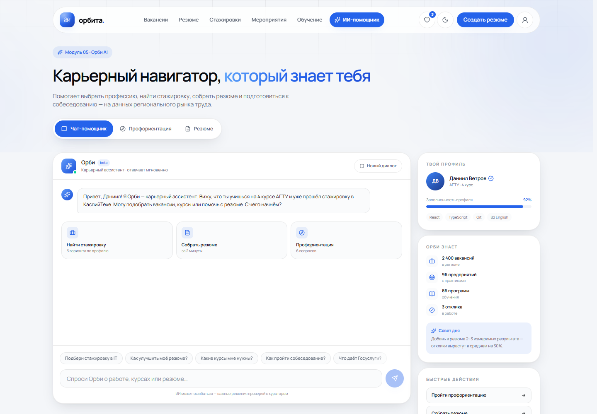
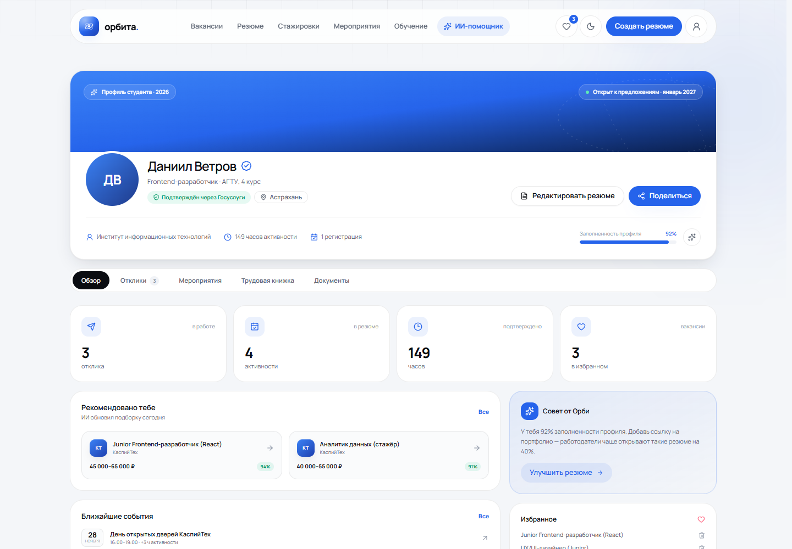
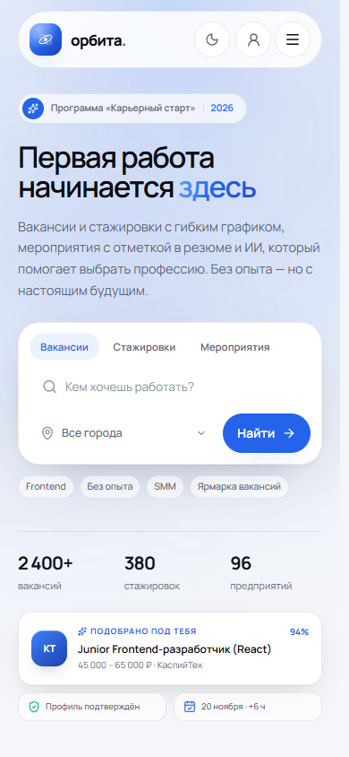

# Орбита — карьерная платформа для студентов

Веб-лицо MVP для поиска работы, стажировок и практики студентов. Один интерфейс, шесть модулей и сквозная логика: вакансия → отклик → мероприятие → отметка в резюме → проверенный профиль.

Демо полностью клиентское: данные захардкожены, авторизации нет, состояние хранится в `localStorage`. Это витрина продукта, а не продакшн-бэкенд.

**[Главная](docs/preview-home.png)** · **[Вакансии](docs/preview-vacancies.png)** · **[Мероприятия](docs/preview-events.png)** · **[ИИ-помощник](docs/preview-ai.png)** · **[Профиль](docs/preview-profile.png)**

| Главная | ИИ-помощник |
| --- | --- |
|  |  |

| Профиль | Мобильная версия |
| --- | --- |
|  |  |

## Модули

| № | Модуль | Где посмотреть | Что работает в демо |
| --- | --- | --- | --- |
| 01 | Вакансии и резюме | `/vacancies`, `/resumes` | Поиск и фильтры, сортировка по совпадению, избранное, карточка вакансии, отклик с сопроводительным письмом (в том числе сгенерированным ИИ), приглашение студентов; в интерфейсе заявлена агрегация hh.ru, «Авито Работа» и SuperJob + прямые вакансии предприятий |
| 02 | Практики и обучение от предприятий | `/internships` | Программа «Карьерный старт»: практики с оплатой и наставником, договор о практике, подача заявки, вероятность оффера |
| 03 | Мероприятия с отметкой в резюме | `/events` | Ярмарки, дни открытых дверей, семинары и хакатоны; регистрация добавляет часы активности и отметку в профиль |
| 04 | Госуслуги и электронная трудовая | `/profile` → «Документы», «Трудовая книжка» | Подтверждение профиля через Госуслуги, проверка СНИЛС, синхронизация записей СФР, приватность |
| 05 | Внутренний ИИ | `/ai` | Чат с подбором вакансий и курсов, профориентационный тест из 6 вопросов, конструктор резюме с улучшением текста и PDF-печатью |
| 06 | Образование и траектория | `/education` | Вузы-партнёры, совместные программы, конструктор траектории «вуз → практика → оффер», заказ на подготовку специалиста с оплатой за качество |

Дополнительно: личный кабинет с откликами, активностью и избранным; тёмная тема; мобильная навигация; тосты и модальные окна.

## Стек

- **React 19** + **TypeScript**, **Vite 8**
- **TanStack Router** — типизированные маршруты и search-параметры
- **TanStack Query** — загрузка данных с имитацией API и скелетонами
- **Zustand** — тема, избранное, отклики, регистрации, резюме (persist в `localStorage`)
- **Framer Motion** — модальные окна, переходы вкладок, мягкие появления
- **Tailwind CSS 4** + `clsx` + `tailwind-merge`
- **lucide-react** — иконки
- **Nginx + Docker** — раздача статики на порту **3001**

Дизайн: синий акцент, светлая и тёмная темы, крупные скругления, мягкие тени, минимум изображений — интерфейсные мокапы вместо стоковых картинок. Вёрстка mobile-first: компактный первый экран, статичные информационные панели вместо «левитирующих» карточек, прокручиваемые фильтры и отдельная компоновка личного кабинета на телефоне.

## Локальный запуск

Требуется Node.js **22+** (используется Vite 8).

```bash
npm ci
npm run dev
# http://localhost:3001
```

Проверка production-сборки:

```bash
npm run build
npm run preview
```

## Docker

Образ собирается в два этапа: Node собирает статику, Nginx раздаёт её на **3001**. На сервере Node не нужен.

```bash
docker build -t orbita-web .
docker run -d --name orbita-web \
  -p 3001:3001 \
  --restart unless-stopped \
  orbita-web
```

Или через Compose:

```bash
docker compose up -d --build
docker compose ps
curl http://localhost:3001/healthz
```

Что учтено для слабого сервера:

- сборка вынесена в CI, сервер только скачивает готовый образ;
- runtime — `nginx:alpine`, без Node.js и dev-зависимостей;
- gzip для HTML/CSS/JS/SVG, кэш хэшированных ассетов на год, `index.html` без кэша;
- healthcheck `/healthz`, `read_only`-контейнер, лимит **128 МБ** и **0.5 CPU** в Compose;
- SPA-fallback и security-заголовки (CSP, `nosniff`, `frame-ancestors`).

## CI/CD (GitHub Actions)

Workflow: [`.github/workflows/ci.yml`](.github/workflows/ci.yml)

- на **push в `main`** и **workflow_dispatch**: `npm ci` → `npm run build` → сборка Docker-образа → push в GHCR;
- на **pull request**: тот же build, но без публикации;
- теги: `latest` (для default-ветки) и `sha-xxxxxxx`;
- кэш Buildx через GitHub Actions cache.

Образ публикуется как:

```
ghcr.io/<owner>/<repo>:latest
ghcr.io/<owner>/<repo>:sha-<commit>
```

Деплой на сервере (без сборки):

```bash
export ORBITA_IMAGE=ghcr.io/<owner>/<repo>:latest

# если пакет приватный
echo "$GHCR_TOKEN" | docker login ghcr.io -u <github-user> --password-stdin

docker compose pull
docker compose up -d --no-build
```

Для обновления достаточно повторить `docker compose pull && docker compose up -d --no-build`. Порт **3001** меняется только в `docker-compose.yml` / `deploy/nginx.conf`, если перед приложением стоит reverse-proxy.

## Структура

```
src/
  components/
    layout/       Header, Footer, Layout, PageHero
    shared/       карточки вакансий, резюме, событий; модальные окна
    ui/           кнопки, бейджи, модалка, тосты, примитивы
  data/           вакансии, резюме, стажировки, события, вузы, профиль, тексты ИИ
  lib/            api-заглушка, форматирование, cn, заголовки страниц
  pages/          Home, Vacancies, VacancyDetail, Resumes, Internships, Events, Education, Ai, Profile, NotFound
  store/          theme, user (persist), ui (тосты)
  index.css       дизайн-токены, темы, анимации
deploy/nginx.conf
Dockerfile
docker-compose.yml
.github/workflows/ci.yml
```

## Демо-сценарии

1. **Отклик.** Откройте вакансию → «Откликнуться» → «Написать с ИИ» → отправьте. Отклик появится в профиле.
2. **Мероприятие → резюме.** Зарегистрируйтесь на ярмарку: часы активности и отметка сразу появятся в профиле.
3. **Профориентация.** `/ai` → «Профориентация» → 6 вопросов → результат с вакансиями и курсами; можно сохранить в профиль.
4. **Резюме.** `/ai` → «Резюме» → «Улучшить с ИИ» → «Сохранить»; «Скачать PDF» открывает печатную версию только с резюме.
5. **Госуслуги.** `/profile?tab=documents` → «Обновить данные» → подтверждение; данные трудовой книжки синхронизируются.
6. **Заказ на подготовку.** `/education` → «Оставить заказ» → заполнить форму → успех.

Состояние демо сбрасывается в `/profile?tab=documents` → «Сбросить демо-данные». Ключи `localStorage`: `orbita-user`, `orbita-theme`.

## Что дальше для продакшена

- API и БД (вакансии, отклики, профили), реальная авторизация;
- интеграция с Госуслугами/СФР через ЕСИА и защищённый бэкенд;
- LLM-провайдер для ИИ-помощника и модерация ответов;
- работодательский кабинет и биллинг «оплата за качество»;
- e2e-тесты (Playwright) и мониторинг.

> Демо-прототип. Компании, вакансии, мероприятия и данные профиля вымышлены и созданы для презентации сценариев.
